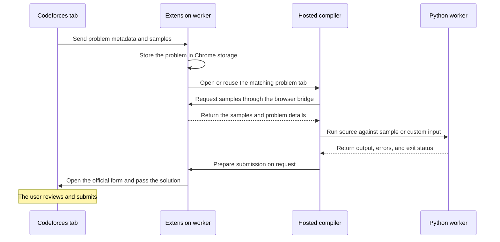

# Skill Issues CP

**A Chrome extension that takes you from a Codeforces problem to a ready-to-run Python workspace.** Open a problem, get its sample inputs and expected outputs in [Skill Issues Compiler](https://skillissuescompiler.vercel.app/), then test your solution and prepare it for submission.

## What it does

- **Imports Codeforces examples.** Reads the title, time limit, memory limit, sample inputs, and expected outputs from the open problem page. Supports the problemset, contests, Gym, and group contests on `codeforces.com`.
- **Runs Python in your browser.** Test your solution against the imported samples or add custom cases. Each test shows its verdict and lets you inspect the actual output and errors.
- **Keeps your work by problem.** Reopen imported problems from the compiler dropdown. Your Python drafts and custom cases are saved in the current browser profile.
- **Prepares a Codeforces submission.** Opens the official form with the problem, an available Python language, and your solution filled in. You review the form and click **Submit** on Codeforces.

## Download and install

**Requires Chrome 116 or later.** The extension is installed as an unpacked folder.

1. Download the packaged `Skill-Issues-CP.zip` and extract it. If your repository download already includes the prebuilt `Skill-Issues-CP/` folder, use that folder directly. For a source-only download, follow [Build from source](#build-from-source).
2. Open `chrome://extensions` and turn on **Developer mode**.
3. Click **Load unpacked** and select the extracted `skill-issues-cp` folder. Select the folder that directly contains `manifest.json`.
4. Open or refresh a Codeforces problem. You can pin **Skill Issues CP** from Chrome’s extensions menu for quick access.

## Use it on a problem

1. Open a problem on Codeforces. The extension imports its examples and opens the hosted compiler in a background tab. Click **Open in Skill Issues** above the problem statement to bring the workspace forward.
2. Write your Python solution and click **Run Tests**. The panel compares actual and expected output by whitespace-separated tokens. Add a custom test when you want to check an edge case.
3. Click **Prepare submission** when you’re ready. Sign in on Codeforces if prompted, review the problem and language, then click its **Submit** button.

The toolbar icon opens the current Codeforces problem or the most recently imported one. Local tests use a five-second execution limit per case. Codeforces handles official verdicts, hidden tests, and interactive judging.

## Architecture



The app uses **Manifest V3**, **vanilla JavaScript**, and **Pyodide 0.29.3**. Vercel serves the static editor and runtime. Each test runs in its own Web Worker using CPython compiled to WebAssembly. Sample imports and submission preparation pass through the browser extension, while the hosted editor uses browser storage for drafts and custom cases.

| File | Role |
| --- | --- |
| [`extension/manifest.json`](extension/manifest.json) | Declares the worker, site access, and browser scripts. |
| [`extension/content.js`](extension/content.js) and [`extension/codeforces.js`](extension/codeforces.js) | Read examples from the Codeforces page, identify the problem URL, and prepare the submission form. |
| [`extension/background.js`](extension/background.js) | Validates messages, stores imported problems, opens compiler tabs, and temporarily stages submissions. |
| [`compiler-page.js`](extension/compiler-page.js), [`compiler-bridge.js`](extension/compiler-bridge.js), and [`cp-bridge.js`](web/cp-bridge.js) | Relay messages between the hosted page and the extension. |
| [`web/app.js`](web/app.js) and [`web/cp.js`](web/cp.js) | Manage the editor, console, problem workspace, custom tests, and test results. |
| [`web/python-worker.js`](web/python-worker.js) | Runs Python with Pyodide and returns output and errors to the editor. |
| [`scripts/`](scripts/) and [`vercel.json`](vercel.json) | Bundle the Python runtime, assemble the extension, and configure the static site deployment. |

## Development

### Build from source

Download or clone this repository. On GitHub, you can also select **Code → Download ZIP** and extract the source. With Node.js and npm installed, run these commands from the project root.

```sh
npm install
npm run build:extension
```

The build creates `dist/skill-issues-cp/`. Load that folder through **Load unpacked**. After rebuilding, click **Reload** on the extension card and refresh any open Codeforces problem tabs.

### Run the editor locally

With Python 3 and the npm dependencies installed, run the following commands.

```sh
npm run build
python3 server.py
```

Open [http://127.0.0.1:4173/](http://127.0.0.1:4173/) to preview the standalone editor. To test the Codeforces workflow, load the extension in Chrome and open a problem. That workflow targets the hosted compiler URL.

The runtime includes [Pyodide](https://github.com/pyodide/pyodide/tree/0.29.3) and the [CPython standard library](https://docs.python.org/3/license.html).
